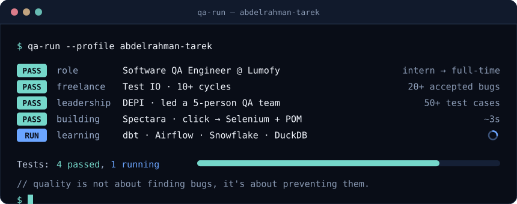
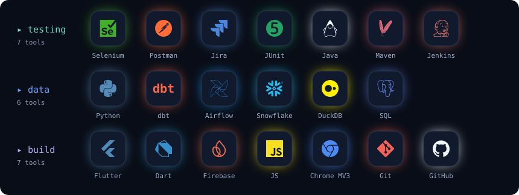

<!-- Banner generated with Higgsfield. Animated SVGs in assets/ are generated, no external services. -->

  

<h1 align="center">Abdelrahman Tarek</h1>

  

  
  
  
  

  

  

<table>
<tr>
<td width="50%" valign="top">

### Spectara
AUTOMATION, REIMAGINED
 

A Chrome extension: click any element and get the most stable locator (ranked, not guessed), a ready-to-paste Selenium Java snippet and a generated Page Object class in about three seconds.

`JavaScript` `Manifest V3` `Selenium` `POM`

🔒 Private repo · <a href="https://abdelrahmant-9.github.io/My-Portfolio/#projects">see it on my portfolio →</a>

</td>
<td width="50%" valign="top">

### DEPI Graduation Project
FIVE PEOPLE, ONE SHARED STANDARD
 

Led a QA team through a full web-app testing lifecycle: 50+ test cases, 15+ documented defects, manual and automated suites, closed out with a committee presentation.

`Java` `Selenium` `TestNG` `Jira` `Team Lead`

<a href="https://github.com/abdelrahmant-9/SoftwareTesting-FinalProject">View repo →</a>

</td>
</tr>
<tr>
<td width="50%" valign="top">

### To-Do & أجر
CODE I REFUSE TO SHIP UNTESTED
 

To-Do uses Clean Architecture + MVVM, Firebase Auth, Firestore, GetIt and AR/EN localization, with unit tests on the domain layer. أجر is an Arabic-first Azkar companion with streaks, Hijri dates and notifications.

`Flutter` `Dart` `Firebase` `Hive` `Unit Tests`

<a href="https://github.com/abdelrahmant-9/To-Do-App">To-Do repo →</a> · 🔒 أجر is private

</td>
<td width="50%" valign="top">

### Data pipelines
TESTING DATA, NOT JUST APPS
 

Warehouses and ELT pipelines with tests at every layer: Snowflake RAW → Bronze → Silver → Gold, a daily Airflow DAG with 23 dbt tests, and 1.2M sales rows modelled into reporting tables.

`dbt` `Airflow` `Snowflake` `DuckDB` `SQL`

<a href="https://github.com/abdelrahmant-9/agrifresh-dwh">agrifresh-dwh</a> · <a href="https://github.com/abdelrahmant-9/ecommerce-dbt-airflow">ecommerce-dbt-airflow</a> · <a href="https://github.com/abdelrahmant-9/sales-1m-dbt">sales-1m-dbt</a> · <a href="https://github.com/abdelrahmant-9/retail-star-schema-dbt">retail-star-schema-dbt</a>

</td>
</tr>
</table>

<b>Open the full list</b>

 

| Project | What it is |
|---|---|
| [QA Reps](https://github.com/abdelrahmant-9/Qa-Reps) | 60 QA project briefs (manual, automation, API, performance) with a ready CV line. English & العربية. [Live →](https://abdelrahmant-9.github.io/Qa-Reps/) |
| [My Portfolio](https://github.com/abdelrahmant-9/My-Portfolio) | Test-runner themed portfolio with a 3D test pyramid and a Spot the Bug game. [Live →](https://abdelrahmant-9.github.io/My-Portfolio/) |
| [BMI App](https://github.com/abdelrahmant-9/BMI-App) | Flutter BMI calculator with real-time calculation. |
| SmartCalc · Listify · QuickText · CountUp | Small focused builds, each drilling one idea: parsing, state, persistence, layout. |

  

<b>Also:</b> manual & exploratory testing · test design · regression · cross-browser · API testing · bug reporting · TestNG · POM · data-driven · Agile / Scrum

  
  

  

  Studying law at Minufiya University, which mostly taught me to read a spec adversarially. That's QA. 
  Open to part-time and volunteer QA work · <a href="https://abdelrahmant-9.github.io/My-Portfolio/#connect">get in touch</a>

